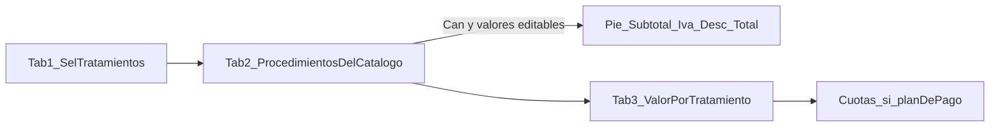

# Facturación — requisitos (plan vivo, sin código)

Contrato de pantalla según Ceere. No hay implementación hasta cerrar presupuesto (4 pestañas), recibo de caja y factura.

Tres momentos:

1. Presupuesto (cotiza el tratamiento)
2. Recibo de caja (registra el pago)
3. Factura (documento fiscal)

UI en español, CSS propio, lo más fiel posible a Ceere. Empresa = sede de sesión (como Agenda). El documento del paciente es un buscador, no un campo suelto.

---

## Pestaña 1 — Información Tratamiento (cerrada con la captura)

Ventana: **Presupuesto**.

Barra de acciones (no son pestañas): Nuevo, Eliminar, Anular, Imprimir, Buscar, Guardar, Cálculo de Cuotas, Salir.

Pestañas: Información Tratamiento | Procedimientos | Forma de Pago | Procedimientos Adicionales.

### Cabecera del tratamiento

| Campo | Comportamiento |
|---|---|
| Presupuesto No | Consecutivo (ej. 20345). No se teclea. |
| Fecha inicio tratamiento | Fecha. En la captura coincide con el día. |
| Fecha aproximada fin tto. | Fecha. |
| Moneda presupuesto | En la captura: Peso. Catálogo, no texto libre. |
| Sede | Empresa de la sesión. En la captura: Federico Zapata Per. |

### Paciente

| Campo | Comportamiento |
|---|---|
| Afiliado | Check. |
| Documento | **Buscador** (mismo patrón que cita/HC: `**`). Al elegir, carga el resto. |
| Nombres | Se llena al elegir paciente. |
| Dirección | Se llena al elegir paciente. |
| Barrio | Se llena al elegir paciente. |
| Teléfono | Se llena al elegir paciente. |
| No póliza | Texto; en la captura default `0000`. |
| Cita | Referencia a cita (vínculo aún por confirmar). |
| Remisión | Texto. |

### Beneficiario (bloque inferior)

Activo cuando el check **Beneficiario** está marcado.

| Campo | Comportamiento |
|---|---|
| Documento | Buscador (`**`). |
| Tipo beneficiario | Catálogo. |
| Parentesco | Catálogo. |

### Tratamientos (derecha)

Título: **Seleccione los Tratamientos**.

Filas de catálogo (no se inventan en pantalla). En la captura:

- Consultas
- Ecografías
- Reuniones
- Fisioterapia
- Procedimientos
- Artículos
- Examenes de laboratorio
- Prueba
- Honorarios
- Examenes de laboratorio suescu
- Examenes de laboratorio genom…

Columnas:

| Columna | Uso |
|---|---|
| Descripción tratamiento | Nombre del tipo (solo lectura). |
| Sel | Check: entra o no en este presupuesto. |
| Profesional responsable | Quién atiende ese tipo. |
| Tarifa | Valor. |
| Fin tto. | Fecha fin de ese tratamiento. |

### Información adicional

| Campo | Comportamiento |
|---|---|
| Entidad que remite | Check + buscador (`**`). |
| Observaciones | Texto largo. |

Pie de ventana: usuario de sesión (ej. Administrador1 Ceere).

### Orígenes SQL (catálogos, sin guardar)

- **Tratamiento** (estado 7, `Documento Empresa` = sede). Si la sede es `documento-1` y el catálogo está en `documento`, se usa ese padre; si no hay filas, `00000000-0`.
- **Tratamiento Items** + **Objeto** → procedimientos al marcar Sel.
- **Precio de Venta** → Precio / IVA / desc. default, por empresa y **Id Tipo Tarifa**.
- **Tipo Tarifa** (estado 7, documento empresa) → combo Tarifa de cada fila.
- **Especialidad Contratada Por Entidad** por **Id Subcapítulo** del tratamiento → combo Profesional.
- **Plan de Tratamiento** (Nro Plan de Tratamiento) = consecutivo. Aún no se lee ni se guarda.

### Decisiones ya tomadas

- Documento paciente = buscador, no digitación ciega.
- Sede = empresa de sesión.
- Presupuesto No = consecutivo generado (aún no persistido).
- Sin DIAN/XML, sin RDA/IHCE en esta fase.

### Abierto (no se asume)

- Si marcar un tratamiento obliga profesional y tarifa antes de Guardar.
- Qué hacen Cita y Remisión (enlace a Agenda u otro documento).
- Si Beneficiario puede ser distinto del paciente afiliado.
- Comportamiento exacto de Anular / Eliminar.
- **Cálculo de Cuotas** rellena las grillas de la pestaña Forma de Pago; el detalle del diálogo aún no se vio.

Cadena entre pestañas:

---

## Pestaña 2 — Procedimientos (cerrada con las capturas)

Es el listado de lo que se va a facturar. Solo aparecen grupos de tratamientos marcados con **Sel** en la pestaña 1 (en las fotos: Consultas y Ecografías). Árbol expandible (`+`/`-`); el encabezado de grupo va en rojo.

Cada ítem se muestra como `código - descripción` (ej. `E03 - Consulta ginecología`, `5121989 - Consulta fertilidad`).

### Columnas

| Columna | Comportamiento |
|---|---|
| Procedimientos | Código y nombre. Solo lectura. |
| Precio | Editable. El catálogo puede traer un valor aunque **Can = 0** (ej. ginecología = 62.000). |
| Can | Editable. Poner cantidad es lo que marca el ítem para facturar (ej. fertilidad, Can = 1). |
| Desc % | Editable. Descuento porcentual de la fila. |
| Desc $ | Editable. Descuento en pesos de la fila. |
| Iva % | Editable. |
| Iva $ | Editable. |
| Observaciones | Editable (ej. «Realizar tratamiento»). |
| Subtotal | Calculado por fila. No se asume la fórmula hasta ver tablas. Precio 0 + Can 1 sigue en 0. |
| Rev | Aún no interpretada. |

Al enfocar una fila aparece un botón `...` a la derecha del nombre (detalle; contenido desconocido).

### Pie izquierdo — filtros (no montos)

- Ver dentición decidua
- Ver dentición mixta
- Ver dentición permanente (marcado en las fotos)
- Ver sólo los tratamientos seleccionados

Filtros de odontología / visibilidad del árbol. No cambian el Valor Total por sí solos.

### Pie derecho — totales del presupuesto

Se van armando con las filas elegidas (cantidad y valores editados):

| Campo | Comportamiento |
|---|---|
| Des Adicional $ | Editable; descuento extra sobre el total. |
| Des Adicional % | Editable; descuento extra porcentual sobre el total. |
| (+) Subtotal | Suma de subtotales de fila. |
| (+) Iva | Suma de IVA. |
| (-) Desc. Adic. | Aplica los descuentos adicionales. |
| **Valor Total** | Resultado final. |

Leyenda en letras debajo: `pesos 00/100 M. L. V.` (moneda en texto; se actualizará cuando el total no sea 0).

### Decisiones de esta pestaña

- Lo marcado en Información Tratamiento **filtra** qué grupos se listan aquí.
- Los valores de precio, cantidad, descuentos e IVA **se pueden editar**.
- Can = 0 deja el ítem en el catálogo visible pero no suma (probable; confirmar con tablas).

### Abierto (no se asume)

- Fórmula exacta de Subtotal / IVA / descuentos de fila vs. Des Adicional.
- Significado de **Rev** y del botón `...`.
- Si «Ver sólo los tratamientos seleccionados» es redundante con el filtro de Sel o muestra también no marcados.

---

## Pestaña 3 — Forma de Pago (cerrada con las capturas)

Tres bloques: forma de pago a la izquierda, valor/cuotas al centro, parámetros del plan a la derecha.

### Izquierda — Forma de Pago

| Campo | Comportamiento |
|---|---|
| Tipo de Pago | Lista. Ids visibles en la captura: **2** Crear un plan de pago por todo el presupuesto (aprobado por el paciente); **3** Crear un plan de pago para cada tratamiento del presupuesto (aprobado por el paciente); **4** Guardar el presupuesto, proceso diagnóstico (sin aprobar por el paciente). |
| Forma de Pago | Lista. Ids visibles: **4** Contado; **5** EPS, Entidad Prepago; **3** Plan de Pago. |
| Responsable | Buscador de **usuario o responsable**. El recuadro vacío debajo muestra el nombre al elegir. |

Cómo conviven Tipo de Pago 2/3/4 con Forma de Pago Contado / EPS / Plan de Pago no se infiere de las fotos.

### Centro — Valor por Tratamiento

Una fila por tratamiento marcado en la pestaña 1 (en las fotos: Consultas y Ecografías).

| Columna | Uso |
|---|---|
| Tratamiento | Nombre del tipo. |
| Valor | Total de ese tratamiento (viene de Procedimientos; en las fotos 0). |
| Check | Encaja con Tipo de Pago 3 (plan por cada tratamiento). |

### Centro — cuotas

Dos grillas con las mismas columnas: Cuota No, No. días, Cap.Falt, Int.Cuota, Cap.Cuota, Vlr.Pagar, Cuota de.

1. **Información cuotas (cuota inicial)**
2. **Información cuotas (capital a financiar)**

En las fotos están vacías. Se espera que las llene **Cálculo de Cuotas** de la barra, no que se recorra a mano.

### Derecha — parámetros del plan

**Información**

| Campo | Comportamiento |
|---|---|
| Plan de Pago | Texto / catálogo (vacío en las fotos). |
| Periodo de Pago | Texto / catálogo. |
| Tipo de Cuota | Texto / catálogo. |
| Inicio Plan de Pago | Fecha (en las fotos = día del presupuesto). |

**Información Cuota Inicial**

| Campo | Comportamiento |
|---|---|
| Valor % Cuota Inicial | Numérico. |
| Valor $ Cuota Inicial | Numérico. |
| Número de Cuotas | Entero. |
| Fecha Primera Cuota | Fecha. |

**Información Capital a Financiar**

| Campo | Comportamiento |
|---|---|
| Capital a Financiar | Numérico. |
| Número de Cuotas | Entero. |
| Valor % Interés | Numérico. |
| Valor % Interés Mora | Numérico. |
| Fecha Primera Cuota | Fecha. |
| Valor Total Tratamiento | Viene de Procedimientos (en las fotos 0). |

### Abierto (no se asume)

- Si Responsable es el paciente, un tercero o un usuario Ceere (el buscador da usuario o responsable; no se eligió nadie en las fotos).
- Relación exacta Tipo de Pago ↔ Forma de Pago ↔ checks de Valor por Tratamiento.
- Contenido del diálogo **Cálculo de Cuotas**.

---

## Pestaña 4 — Procedimientos Adicionales

Pendiente de captura.

## Recibo de caja

Pendiente de captura.

## Factura

Pendiente de captura.

## Siguiente

Catálogos de presupuesto ya se leen de Ceere (Tratamiento, ítems, Precio de Venta, Tipo Tarifa, profesionales). Aún no se guarda el Plan de Tratamiento. Siguiente: pestaña **Procedimientos Adicionales**, luego recibo de caja y factura.